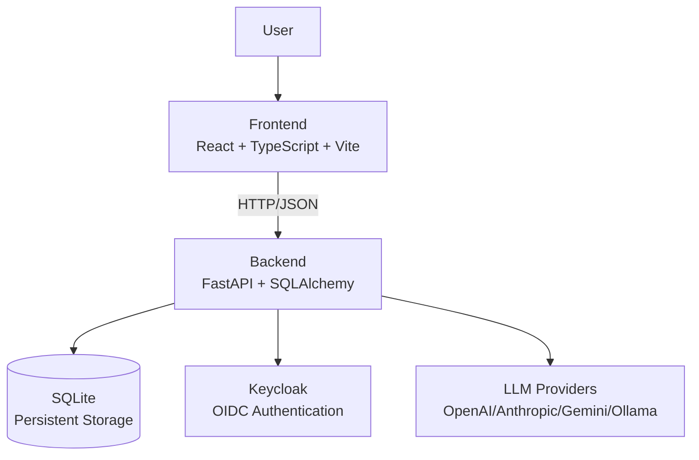

# Orbit Studio

> Work in progress. This checkpoint may be incomplete or fail tests. See PLAN.md and STATUS.md before use.


**Alan Vo | AI & Machine Learning**  
alanvo@gmail.com

An AI Engineering issue tracker for managing factual and self-contradiction errors in technical documentation. Built to learn, build, and ship AI engineering workflows.

## Problem

AI engineering educational content (like the *AI Engineering from Scratch* curriculum) contains factual errors and self-contradictions across phases and lessons. Translators and reviewers need a systematic way to track, validate, and resolve these issues with AI-assisted explanations.

## Implemented AI/ML Approach

- **Issue Tracker Core**: CRUD API for documenting factual errors with structured metadata (phase, lesson, issue type, severity)
- **LLM Explanation Engine** (planned): Opt-in advisory explanations for detected issues using configurable LLM providers (OpenAI-compatible, Anthropic, Gemini, Ollama)
- **AI/ML Evaluation Workflow** (planned): Reproducible baseline for evaluating LLM accuracy on detecting known factual errors from a labeled dataset

## Features

- **Structured Issue Tracking**: Issues categorized by phase, lesson, type (factual/contradiction), and severity
- **Pagination & Filtering**: List issues with filters for phase, lesson, type, status
- **Health Monitoring**: `/health` endpoint for service status
- **Docker Deployment**: Multi-container setup with Keycloak OIDC authentication
- **Responsive UI**: React + TypeScript dashboard with loading/error/empty states

## Architecture



## Quick Start

### Prerequisites

- Docker & Docker Compose
- Node 24+ (for local frontend development)
- Python 3.12+ (for local backend development)

### Using Docker Compose (Recommended)

```bash
# Start all services
docker compose up -d

# View logs
docker compose logs -f

# Stop services
docker compose down
```

Services available at:
- Frontend: http://localhost:3000
- Backend API: http://localhost:8000
- API Docs: http://localhost:8000/docs
- Keycloak: http://localhost:8080 (admin/admin)

### Local Development

**Backend:**
```bash
cd backend
python -m venv .venv
source .venv/bin/activate
pip install -r requirements.txt
uvicorn app.main:app --reload --host 0.0.0.0 --port 8000
```

**Frontend:**
```bash
cd frontend
npm install
npm run dev
```

## Testing

### Backend Tests
```bash
cd backend
source .venv/bin/activate
PYTHONPATH=. pytest tests/ -v
```

### Frontend Tests
```bash
cd frontend
npm test
```

### Full Test Suite
```bash
# Backend
cd backend && PYTHONPATH=. pytest tests/ -v

# Frontend
cd frontend && npm test
```

## API Reference

### Health Check
```
GET /health
Response: { "status": "ok", "version": "1.0.0", "environment": "development", "demo_mode": true }
```

### Root
```
GET /
Response: { "message": "Orbit Studio API", "version": "1.0.0", "docs": "/docs" }
```

## Security Limitations

- Demo mode binds to localhost only; refuses to start in production without proper credentials
- LLM_API_KEY is the only LLM credential variable; never logged or exposed to frontend
- OIDC tokens validated with signature/issuer/audience checks
- CSRF protection on cookie-authenticated writes
- No hardcoded secrets; all credentials via environment variables

## Provider Configuration

| Variable | Description | Required |
|----------|-------------|----------|
| LLM_PROVIDER | Provider: openai-compatible, anthropic, gemini, ollama | No |
| LLM_MODEL | Model identifier | No |
| LLM_BASE_URL | Base URL for OpenAI-compatible/Ollama | No |
| LLM_API_KEY | API key for LLM provider | Yes (for LLM features) |

## SSO/SAML Setup

Keycloak supports upstream SAML IdPs through identity brokering:
1. Configure SAML Identity Provider in Keycloak Admin Console
2. Map SAML attributes to Keycloak user attributes
3. Enable broker on the orbit-studio frontend client
4. Users can then login via corporate SAML IdP

## Backup & Restore

```bash
# Backup SQLite database
docker compose exec backend cp /app/data/app.db /app/data/app.db.backup

# Restore
docker compose exec backend cp /app/data/app.db.backup /app/data/app.db
```

## TLS Reverse Proxy

For production, deploy behind a TLS-terminating reverse proxy (nginx, Traefik, Caddy):
- Terminate TLS at proxy
- Forward HTTP to backend:8000 and frontend:3000
- Set `X-Forwarded-Proto: https` header
- Configure Keycloak `proxy: edge` for correct redirect URIs

---

**Alan Vo**  
alanvo@gmail.com  
AI & Machine Learning